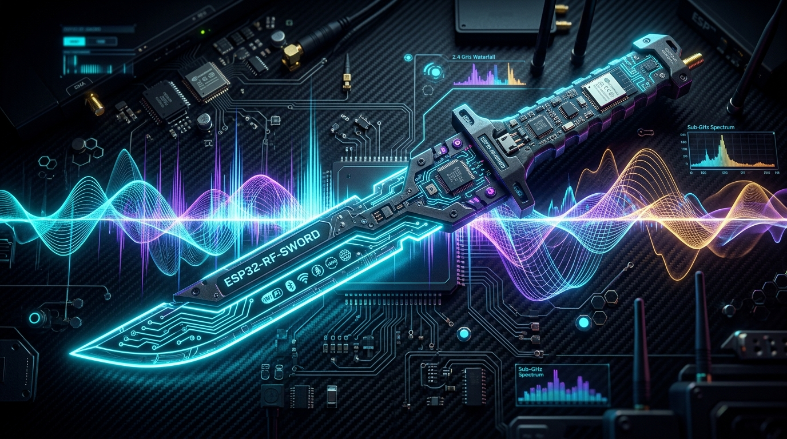
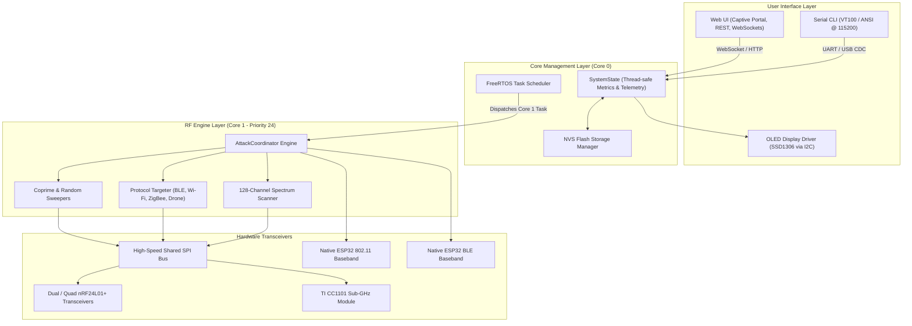

<!-- well-document · audit scorecard: G1:5 G2:5 G3:5 G4:5 G5:5 G6:5 · STATUS: PASS -->

<p align="center">
  
</p>

<h1 align="center">ESP32-RF-SWORD</h1>
<p align="center">
  <strong>Multi-Band Radio Frequency Transmission, Spectrum Analysis, and Security Research Framework</strong>
</p>

<p align="center">
  <a href="https://github.com/AtaCanYmc/esp32-rf-sword/actions/workflows/ci.yml"></a>
  <a href="https://github.com/AtaCanYmc/esp32-rf-sword/releases/tag/v0.2.0"></a>
  <a href="https://atacanymc.github.io/esp32-rf-sword/"></a>
  <a href="https://espressif.com"></a>
  <a href="https://platformio.org"></a>
  <a href="docs/PINOUTS.md"></a>
  <a href="docs/FREQUENCY_GUIDE.md"></a>
  <a href="LICENSE"></a>
</p>

ESP32-RF-SWORD is a modular radio frequency (RF) research, spectrum analysis, and signal transmission framework built for Espressif microcontrollers (ESP32 Classic, ESP32-S3, ESP32-C3, and ESP32-C6).

The firmware coordinates multi-transceiver SPI arrays (nRF24L01+ and TI CC1101) alongside native 802.11 and Bluetooth Low Energy (BLE) basebands. A FreeRTOS dual-core task architecture isolates microsecond-critical radio hopping routines on Core 1 while dedicating Core 0 to real-time WebSockets, captive portal HTTP services, and an interactive VT100 serial CLI.

---

## Table of Contents

- [System Overview](#system-overview)
- [Comparison with Legacy Implementations](#comparison-with-legacy-implementations)
- [System Architecture](#system-architecture)
- [Repository Layout](#repository-layout)
- [Hardware Wiring and Pinout Matrix](#hardware-wiring-and-pinout-matrix)
- [Building and Flashing](#building-and-flashing)
- [Interactive Serial CLI Shell](#interactive-serial-cli-shell)
- [Embedded Web Dashboard](#embedded-web-dashboard)
- [Automated Testing and Verification](#automated-testing-and-verification)
- [Technical Documentation Index](#technical-documentation-index)
- [Frequently Asked Questions](#frequently-asked-questions)
- [Regulatory and Legal Notice](#regulatory-and-legal-notice)
- [License](#license)

---

## System Overview

ESP32-RF-SWORD implements five core functional subsystems:

1. **Multi-Transceiver 2.4 GHz Sweeper Array**:
   - Supports dual and quad nRF24L01+ modules concurrently over a high-speed shared SPI bus up to 20 MHz.
   - Implements coprime stride channel permutation ($\gcd(S, N) = 1$) to guarantee uniform, non-repeating spectrum dispersion across 2400 to 2525 MHz.
   - Configurable Gaussian dwell jitter (10 to 5000 µs) prevents harmonic lock from external spectrum tracking tools.
   - Employs quadrature phase offsets across physical transceivers to avoid mutual radio front-end saturation.

2. **Targeted Protocol Interdiction**:
   - **Bluetooth Low Energy (BLE)**: Focuses transmission on Primary Advertising Channels (Channel 37 at 2402 MHz, Channel 38 at 2426 MHz, and Channel 39 at 2480 MHz) or general data channels.
   - **Wi-Fi 802.11 b/g/n**: Channel-locked transmission targeted at standard 20 MHz / 40 MHz channel boundaries (Channel 1 at 2412 MHz, Channel 6 at 2437 MHz, Channel 11 at 2462 MHz).
   - **IEEE 802.15.4 / ZigBee / Thread**: Spans channels 11 through 26 (2405 to 2480 MHz, 5 MHz channel spacing).
   - **RC UAV Control Links**: Targeted interference profiles for FlySky AFHDS, FrSky ACCST, and ExpressLRS links.

3. **Sub-GHz Transceiver Engine (TI CC1101)**:
   - Covers ISM frequency allocations: 315 MHz, 433.92 MHz, 868.35 MHz, and 915 MHz.
   - Supports unmodulated Continuous Wave (CW) carrier emission, OOK/FSK modulated pseudorandom noise, and sweep profiles.

4. **Native ESP32 802.11 and BLE Injection**:
   - **802.11 Frame Injection**: Raw beacon frame broadcasting with custom SSID pools, sequence permutation, and deauthentication frame transmission for penetration auditing.
   - **BLE Advertisement Flooding**: Emulates Apple AirDrop/AirPods proximity pairs, Android Google FastPair beacons, and Microsoft SwiftPair discovery packets.

5. **Real-Time Spectrum Analyzer**:
   - Sweeps 128 discrete 1 MHz bins using nRF24L01+ Carrier Detect (CD / RPD) registers.
   - Feeds a circular waterfall buffer streamed to the Web dashboard via WebSockets and visualizable in the serial terminal as an ASCII bar chart.

---

## Comparison with Legacy Implementations

ESP32-RF-SWORD replaces single-file monolithic prototypes (such as `pepeangell5/RF-KILL`) with an object-oriented, testable architecture:

| Feature | Legacy RF-KILL | ESP32-RF-SWORD |
| :--- | :--- | :--- |
| **Architecture** | Monolithic single `.cpp` file | Modular C++ layer separation (HAL, Radio, UI, Core) |
| **Target Hardware** | Hardcoded to single ESP32-C3 board | ESP32 Classic, ESP32-S3, ESP32-C3, ESP32-C6 |
| **Radio Interfaces** | 2x nRF24 modules only | Dual/Quad nRF24 (2.4 GHz) + CC1101 (Sub-GHz) + Native ESP32 baseband |
| **Concurrency Model** | Single blocking `loop()` | FreeRTOS Dual-Core (Core 1: RF Worker @ Pri 24; Core 0: Network & UI) |
| **Control Interfaces** | Headless serial output | Embedded Captive Portal Web UI, ANSI Serial CLI, I2C OLED HUD |
| **Real-Time Telemetry**| Unstructured serial logs | 10 Hz binary/JSON WebSocket stream + 60 FPS HTML5 Canvas waterfall |
| **Spectrum Analysis** | Not supported | 128-channel 2.4 GHz RSSI scanner with circular history buffer |
| **Native 802.11/BLE** | Not supported | Raw 802.11 Beacon/Deauth frame injection + BLE discovery flooding |
| **Sub-GHz Transceiver** | Not supported | TI CC1101 support across 315, 433.92, 868.35, and 915 MHz |
| **Configuration** | Compile-time macro definitions | Non-Volatile Storage (NVS) persistence with runtime CLI/Web updates |
| **Automated Testing** | None | Host-side native test suite executed in continuous integration |

---

## System Architecture

The runtime architecture separates timing-critical radio transactions from asynchronous networking and user interfaces:



---

## Repository Layout

```text
esp32-rf-sword/
├── .github/
│   ├── workflows/
│   │   ├── ci.yml                 # CI test runner and multi-target firmware build matrix
│   │   ├── pages.yml              # GitHub Pages deployment for Web Flasher
│   │   ├── release.yml            # Release asset packager
│   │   └── release-please.yml     # Automated changelog and semantic tagging
│   └── dependabot.yml             # Weekly dependency updater
├── data/                          # LittleFS / SPIFFS filesystem storage
├── docs/                          # Technical reference specifications
│   ├── ARCHITECTURE.md            # Hardware arbitration, FreeRTOS scheduling, and jitter physics
│   ├── CLI_REFERENCE.md           # Serial console syntax and command dictionary
│   ├── FREQUENCY_GUIDE.md         # Channel allocations and frequency tables
│   ├── PINOUTS.md                 # Complete pin assignments, schematics, and capacitor guides
│   ├── WEB_INTERFACE.md           # WebSocket protocol schema and captive portal routing
│   └── README.md                  # Secondary documentation index
├── flasher/                       # Web Serial PWA installer (hosted on GitHub Pages)
├── include/                       # Public C++ header files
│   ├── analyzer/                  # Spectrum scanning and circular buffer headers
│   ├── attack/                    # Hopping algorithms and target profile headers
│   ├── core/                      # System state, NVS storage, and task management
│   ├── hal/                       # Hardware abstraction layer and pin mappings
│   ├── radio/                     # SPI bus arbitration and transceiver drivers
│   └── ui/                        # Web server, CLI shell, and OLED HUD headers
├── scripts/                       # Automation and helper tooling
│   ├── bundle_web.py              # Compresses web/ into include/ui/WebAssets.h
│   └── merge_bin.py               # Generates unified 0x0 offset firmware binaries
├── src/                           # C++ implementation source code
├── test/                          # Unit tests executable on host platform (Clang / GCC)
├── web/                           # Embedded web interface source assets
│   ├── index.html                 # Single-page dashboard markup
│   ├── style.css                  # UI layout and styling
│   └── app.js                     # Canvas waterfall visualizer and WebSocket client
├── partitions.csv                 # Custom flash partition table
└── platformio.ini                 # PlatformIO build configurations and environment definitions
```

---

## Hardware Wiring and Pinout Matrix

The high-speed SPI bus (SCK, MISO, MOSI) is shared across all external transceivers. Individual module Chip Select Not (CSN) and Chip Enable (CE) lines isolate each radio:

### ESP32-C3 SuperMini (Compact 2.4 GHz Engine)

| Signal Line | ESP32-C3 GPIO | Target Module | Function |
| :--- | :--- | :--- | :--- |
| **SPI SCK** | `GPIO 4` | nRF24 #1 / #2 & CC1101 | Shared SPI Clock (up to 20 MHz) |
| **SPI MISO** | `GPIO 5` | nRF24 #1 / #2 & CC1101 | Shared Master In Slave Out |
| **SPI MOSI** | `GPIO 6` | nRF24 #1 / #2 & CC1101 | Shared Master Out Slave In |
| **Radio 1 CE / CSN** | `GPIO 3` / `GPIO 7` | nRF24 Transceiver #1 | Transmitter control and chip select |
| **Radio 2 CE / CSN** | `GPIO 1` / `GPIO 10` | nRF24 Transceiver #2 | Transmitter control and chip select |
| **CC1101 CSN / GDO0** | `GPIO 0` / `GPIO 2` | TI CC1101 Sub-GHz | Sub-GHz chip select and digital I/O |
| **I2C SDA / SCL** | `GPIO 8` / `GPIO 9` | SSD1306 OLED (0x3C) | Serial data and serial clock |

### ESP32 DevKit V1 / WROOM-32 (Standard Dual-Core)

| Signal Line | ESP32 GPIO | Target Module | Function |
| :--- | :--- | :--- | :--- |
| **SPI SCK / MISO / MOSI** | `GPIO 18` / `GPIO 19` / `GPIO 23` | All External Modules | Shared Hardware VSPI Bus |
| **Radio 1 CE / CSN** | `GPIO 4` / `GPIO 5` | nRF24 Transceiver #1 | Primary 2.4 GHz module |
| **Radio 2 CE / CSN** | `GPIO 2` / `GPIO 15` | nRF24 Transceiver #2 | Secondary 2.4 GHz module |
| **Radio 3 CE / CSN** | `GPIO 13` / `GPIO 12` | nRF24 Transceiver #3 | Tertiary 2.4 GHz module |
| **Radio 4 CE / CSN** | `GPIO 14` / `GPIO 27` | nRF24 Transceiver #4 | Quaternary 2.4 GHz module |
| **CC1101 CSN / GDO0 / GDO2** | `GPIO 26` / `GPIO 25` / `GPIO 33` | TI CC1101 Sub-GHz | Sub-GHz module control lines |
| **I2C SDA / SCL** | `GPIO 21` / `GPIO 22` | SSD1306 OLED (0x3C) | Display interface |

For ESP32-S3 and ESP32-C6 pin mappings, refer to [docs/PINOUTS.md](docs/PINOUTS.md).

---

## Building and Flashing

### Prerequisites

- [PlatformIO Core](https://platformio.org/install/cli) (v6.1.0 or newer) or PlatformIO IDE extension.
- Python 3.8 or newer.

### Installation Steps

```bash
# 1. Clone repository
git clone https://github.com/AtaCanYmc/esp32-rf-sword.git
cd esp32-rf-sword

# 2. Build and upload for your specific target environment
# Target: ESP32-C3 SuperMini
pio run -e esp32-c3-supermini --target upload

# Target: ESP32 DevKit V1 (WROOM-32)
pio run -e esp32-devkit-v1 --target upload

# Target: ESP32-S3 DevKit
pio run -e esp32-s3-devkit --target upload

# Target: ESP32-C6 DevKit
pio run -e esp32-c6-devkit --target upload

# 3. Open serial monitor at 115200 baud
pio device monitor -b 115200
```

Alternatively, use the browser-based installer without compiling from source: [ESP32-RF-SWORD Web Flasher](https://atacanymc.github.io/esp32-rf-sword/).

---

## Interactive Serial CLI Shell

Connect to the USB UART/CDC port at **115200 baud**. The CLI responds to standard VT100/ANSI commands:

```text
sword > status
=== SYSTEM TELEMETRY & STATUS ===
  State          : RUNNING
  Active Mode    : SWEEP_COPRIME
  Active Preset  : Full Band 2.4GHz (2402-2480 MHz)
  Hop Rate       : 6,480 hops/sec (Total: 48,120)
  Packet Rate    : 1,220 packets/sec (Total: 8,400)
  RF Power       : MAX (0 dBm / +20dBm PA)
  Channel Range  : Ch 2 (2402 MHz) -> Ch 80 (2480 MHz)
  Dwell Jitter   : 120 - 180 us
  Active Radios  : 2 connected
    Radio #1: Active=YES, Ch=42 (2442.0 MHz), TotalHops=24060
    Radio #2: Active=YES, Ch=81 (2481.0 MHz), TotalHops=24060
  Uptime / Heap  : 45 sec | Free Heap: 198420 bytes (Min: 182100)
```

### CLI Command Reference

| Command | Arguments | Description |
| :--- | :--- | :--- |
| `status` | None | Displays live radio channels, hop rates, uptime, and memory heap. |
| `start` | None | Activates transmission on configured radio modules. |
| `stop` | None | Halts all active transmissions and places radios into standby. |
| `mode` | `<coprime\|linear\|random\|ble\|wifi\|zigbee\|drone\|subghz\|noise\|spectrum\|beacon\|deauth\|popup\|blitz>` | Sets the active transmission profile. |
| `preset` | `<full\|ble-adv\|ble-all\|wifi-1\|wifi-6\|wifi-11\|zigbee\|flysky\|frsky\|elrs\|sub-315\|sub-433\|sub-868\|sub-915>` | Applies calibrated frequency boundaries. |
| `channels` | `<min> <max>` | Overrides channel boundaries (0 to 127). |
| `dwell` | `<min_us> <max_us>` | Sets random Gaussian dwell time boundaries in microseconds. |
| `power` | `<min\|low\|high\|max>` | Sets RF power output attenuation. |
| `spectrum` | None | Prints real-time ASCII 2.4 GHz spectrum chart in terminal. |
| `pinout` | None | Prints compiled GPIO pin mapping for the running board. |
| `save` | None | Writes active settings to non-volatile flash storage (NVS). |
| `reset` | None | Restores default factory parameters. |
| `reboot` | None | Executes software microcontroller reset. |

---

## Embedded Web Dashboard

Upon boot, the firmware creates a standalone Wi-Fi Access Point with Captive Portal redirection:

| Parameter | Configuration |
| :--- | :--- |
| **SSID** | `SWORD-SECURITY-PORTAL` |
| **Password** | `rfsword123` |
| **Gateway IP** | `http://192.168.4.1` |
| **Captive Portal** | Automatic DNS redirect via internal DNS server on UDP port 53 |
| **WebSocket Endpoint** | `ws://192.168.4.1/ws` |

The web interface is compiled into firmware flash memory via [scripts/bundle_web.py](scripts/bundle_web.py). It operates entirely offline without external internet connectivity or content delivery network (CDN) dependencies.

---

## Automated Testing and Verification

Run the host-side native C++ test suite without physical microcontroller hardware:

```bash
clang++ -std=c++17 -DHOST_SIMULATION -Iinclude -Isrc -Itest \
  test/test_main.cpp test/test_channel_math.cpp test/test_presets.cpp \
  test/test_waterfall.cpp test/test_system_state.cpp \
  src/radio/ChannelMath.cpp src/attack/Presets.cpp \
  src/analyzer/WaterfallBuffer.cpp src/core/SystemState.cpp \
  -o /tmp/sword_test && /tmp/sword_test
```

To verify web assets are synchronized with `include/ui/WebAssets.h`:

```bash
python3 scripts/bundle_web.py
git diff --exit-code include/ui/WebAssets.h
```

---

## Technical Documentation Index

Detailed technical specifications are maintained in the [docs/](docs/README.md) directory:

- [docs/ARCHITECTURE.md](docs/ARCHITECTURE.md): Microcontroller scheduling, SPI bus contention prevention, and jitter models.
- [docs/PINOUTS.md](docs/PINOUTS.md): Detailed pin mapping, decoupling capacitor requirements, and hardware design notes.
- [docs/CLI_REFERENCE.md](docs/CLI_REFERENCE.md): Terminal interaction syntax and script integration examples.
- [docs/WEB_INTERFACE.md](docs/WEB_INTERFACE.md): WebSocket serialization formats and REST endpoint documentation.
- [docs/FREQUENCY_GUIDE.md](docs/FREQUENCY_GUIDE.md): ISM frequency tables and channel calculations across 2.4 GHz and Sub-GHz bands.
- [SECURITY.md](SECURITY.md): Ethical use policy and vulnerability disclosure procedure.

---

## Frequently Asked Questions

#### Why use multiple nRF24L01+ transceivers instead of a single module?
A single nRF24L01+ transceiver requires tens of microseconds for frequency synthesizer re-locking when changing channels. By distributing hops across two or four transceivers using interleaved quadrature offsets, the framework achieves continuous spectrum occupation and eliminates synthesizer blind spots.

#### Why isolate radio tasks to Core 1 in FreeRTOS?
The ESP32 network stack (Wi-Fi TCP/IP, WebSockets, and HTTP request routing) runs asynchronously on Core 0. Running timing-critical RF transmission loops on Core 0 would introduce millisecond-level scheduling latency during network I/O. Assigning the RF worker to Core 1 at priority 24 guarantees microsecond-level timing repeatability.

#### Does the web dashboard transmit telemetry to third-party servers?
No. The web interface operates entirely offline. Static HTML, CSS, and JavaScript assets are bundled directly into the microcontroller flash memory, and all WebSocket communications remain within the local access point subnet.

#### How is bus contention avoided on the shared SPI bus?
All external radio modules share the hardware SPI lines (SCK, MISO, MOSI) while keeping independent Chip Select Not (CSN) lines. The SPI bus manager drives CSN high for all inactive modules before asserting CSN low for the active transceiver, preventing simultaneous MISO drive.

---

## Regulatory and Legal Notice

> [!CAUTION]
> **ESP32-RF-SWORD is intended solely for authorized security auditing, academic research, and controlled RF testing inside Faraday cages or anechoic chambers.**
> 
> Unauthorized radio frequency transmission or intentional interference with wireless networks is illegal under telecommunications regulations, including FCC Title 47 Part 15 (United States), the Radio Equipment Directive 2014/53/EU (European Union), and ITU Radio Regulations.
> 
> The project authors accept no liability for non-compliant operation or damages resulting from the use of this software.

---

## License

The primary source code of ESP32-RF-SWORD is licensed under the [MIT License](LICENSE).

Because firmware builds statically link against the `nrf24/RF24` library (licensed under the GNU General Public License v2.0), assembled binary distributions combining these components are subject to the terms of the GNU General Public License v2.0. Refer to [LICENSE](LICENSE) for component-level licensing details.
