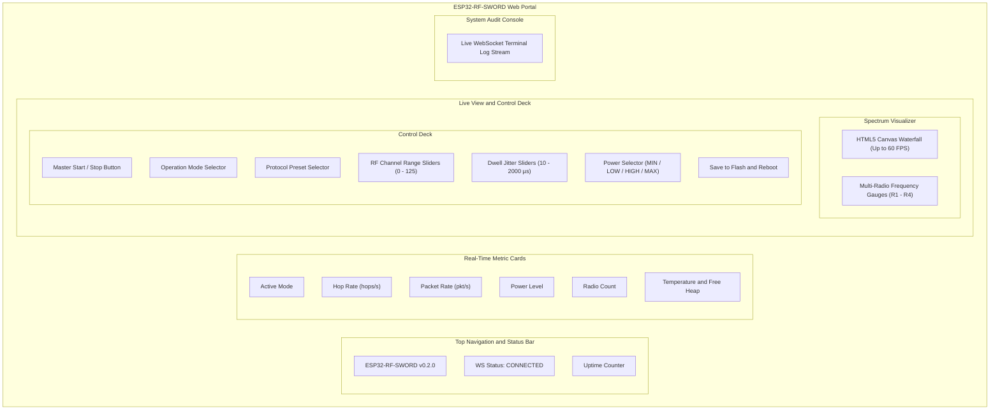
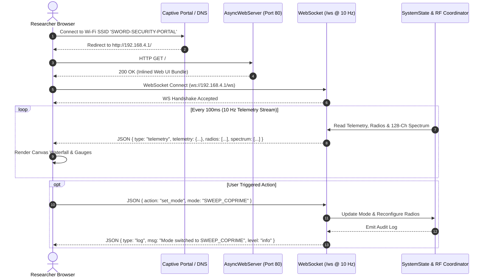

<!-- well-document · audit scorecard: G1:5 G2:5 G3:5 G4:5 G5:5 G6:5 · STATUS: PASS -->

[← Back to Root Repository](../README.md)

# Embedded Web Dashboard and API Guide

ESP32-RF-SWORD hosts a standalone, responsive Single Page Application directly from the microcontroller flash memory.

---

## Connecting to the Web Portal

1. **Connect to Wi-Fi**:
   - **SSID**: `SWORD-SECURITY-PORTAL`
   - **Password**: `rfsword123`
   - **Default IP**: `192.168.4.1`

2. **Captive Portal**:
   - When connecting on iOS, Android, macOS, or Windows, the captive portal detection service launches the dashboard.
   - Alternatively, open `http://192.168.4.1` or `http://sword.local` in any modern web browser.

---

## Web Dashboard Architecture



---

## WebSocket Lifecycle and Communication Flow



---

## WebSocket Protocol Specification (`/ws`)

The WebSocket interface streams JSON telemetry frames at 10 Hz and receives real-time JSON command messages.

### Incoming Command Message Format

```json
{
  "action": "set_mode",
  "mode": "SWEEP_COPRIME"
}
```

#### Available Actions

| Action | Payload Example | Description |
| :--- | :--- | :--- |
| `toggle_run` | `{"action": "toggle_run", "run": true}` | Starts or stops RF transmission. |
| `set_mode` | `{"action": "set_mode", "mode": "SWEEP_COPRIME"}` | Sets active transmission mode. |
| `set_preset` | `{"action": "set_preset", "preset": "BLE_ADV"}` | Applies pre-defined protocol boundaries. |
| `set_channels`| `{"action": "set_channels", "min": 2, "max": 80}`| Sets custom channel bounds (0 to 125). |
| `set_dwell` | `{"action": "set_dwell", "min": 120, "max": 180}`| Sets Gaussian dwell jitter boundaries in µs. |
| `set_power` | `{"action": "set_power", "power": "MAX"}` | Sets RF power attenuation (MIN, LOW, HIGH, MAX). |
| `save_config` | `{"action": "save_config"}` | Flashes current settings to NVS storage. |
| `reboot` | `{"action": "reboot"}` | Reboots the microcontroller. |

### Outgoing Telemetry Message Format

```json
{
  "type": "telemetry",
  "telemetry": {
    "uptime": 142,
    "freeHeap": 194560,
    "tempC": 42.5,
    "hopsPerSec": 6520,
    "packetsPerSec": 1240,
    "mode": "SWEEP_COPRIME",
    "preset": "Full Band 2.4GHz",
    "power": "MAX (0 dBm / +20dBm PA)",
    "radioCount": 2,
    "running": true
  },
  "radios": [
    {"present": true, "active": true, "channel": 42, "freq": 2442.0},
    {"present": true, "active": true, "channel": 81, "freq": 2481.0}
  ],
  "spectrum": [0, 0, 45, 80, 100, 20, 0, 0]
}
```
